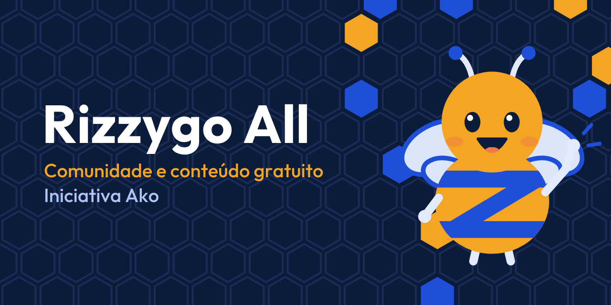

# Iniciativa Ako

Guias abertos e gratuitos para quem está começando em tecnologia e quer usar IA sem deixar de entender o que está fazendo.

Ako é uma filosofia maori que se refere à relação de reciprocidade entre quem ensina e quem aprende: quem ensina também aprende, e quem aprende também ensina.

A Iniciativa Ako é um dos pilares da [Rizzygo](https://github.com/rizzygo), comunidade para quem quer começar em tecnologia e para quem começou há pouco.

**Comece pela [Rizzygo Ako](https://ako.rizzygo.com.br/trilhas/), as trilhas de estudo da iniciativa:** responda quatro perguntas, receba seu roteiro de estudos em TI e avance com materiais gratuitos, desafios práticos e conquistas.

## Trilhas, guias e skills publicados

Cada conteúdo novo entra nesta tabela.

| Conteúdo | Para que serve | Tempo |
| --- | --- | --- |
| [Trilha Primeiros passos em TI](https://ako.rizzygo.com.br/trilhas/) ([conteúdo](trilhas)) | Montar seu roteiro de estudos e aprender a base que toda área usa, de como estudar até um primeiro projeto no GitHub. | 16 tópicos, no seu ritmo |
| [Mapas das áreas da TI](https://ako.rizzygo.com.br/trilhas/mapas/) ([conteúdo](trilhas/dados/mapas.json)) | Ver, em grafo, o que estudar em cada área depois da trilha: infraestrutura e cloud, desenvolvimento, dados, QA, segurança e produto. | 6 mapas de área, de 16 a 23 tópicos cada, e um mapa da trilha |
| [Dicas antes de rodar](guias/dicas-antes-de-rodar-prompt) ([versão em página](https://ako.rizzygo.com.br/guias/dicas-antes-de-rodar-prompt/pagina.html)) | Configurar sua IA para explicar o que um comando muda, como desfazer e como conferir o resultado. | 5 a 10 minutos |
| [Skill antes-de-rodar](skills/antes-de-rodar) | Fazer sua IA de código (Claude Code, GitHub Copilot, Cortex Code) confirmar o contexto, seguir guard rails contra alucinação e retrabalho e fechar toda mudança com "Antes de rodar". | 2 minutos para instalar |

## Três ideias por trás dos guias: base, questionamento e mão de duas vias

- **Base primeiro.** Entender o fundamento vale mais que decorar a ferramenta da moda.
- **Questionar sempre.** Perguntar "existe outro jeito de fazer?" é o que faz você subir de nível.
- **Mão de duas vias.** Todo conteúdo é um ponto de partida. Quem usa pode melhorar, e quem melhora também aprende.

A IA ajuda muito, mas entender como as coisas funcionam continua sendo responsabilidade de quem usa.

## Como um guia vira skill ou plugin

Um guia pode passar por três formatos.

1. **Guia:** passo a passo curto, para ler e aplicar no mesmo dia.
2. **Instrução para IA:** texto pronto para colar no ChatGPT, no Claude, no Gemini ou no Copilot.
3. **Skill ou plugin:** quando um guia funciona bem, ele vira um pacote instalável, e a IA passa a seguir o padrão sem você precisar lembrar.

## Onde fica publicado

O site está em **https://ako.rizzygo.com.br**, no Cloudflare Pages. Cada commit na `main` publica uma versão nova sozinho, e cada pull request ganha um endereço de prévia para conferir antes do merge. Não há build: o Pages serve os arquivos deste repositório como estão, e `_redirects` e `_headers` ajustam a raiz e os cabeçalhos.

## A Zumi, abelha da comunidade

A Zumi é a mascote da Rizzygo All. Onde ela aparece, o conteúdo é gratuito e aberto a todos. As listras da barriga são o Z do logo da Rizzygo. As imagens usadas aqui ficam em [`zumi/`](zumi).

## Como ajudar a melhorar os guias

Achou um erro, tem uma pergunta melhor ou quer adaptar um guia para outra ferramenta? Abra uma [issue](../../issues) (um tópico de conversa no GitHub) ou mande um pull request (uma proposta de alteração). O passo a passo está em [CONTRIBUTING.md](CONTRIBUTING.md).

Nunca contribuiu com um projeto no GitHub? Abrir sua primeira issue aqui é um bom treino.

## Licença CC BY 4.0

Você pode usar, adaptar e compartilhar os conteúdos, inclusive no trabalho, desde que cite a Rizzygo como fonte. O texto completo está em [LICENSE](LICENSE). O nome Rizzygo, o logo e a Zumi são marcas da Rizzygo e ficam fora dessa licença: use as imagens para falar da comunidade, sem alterar nem criar produtos com elas.

---

Criado por Danilo Rizzo e mantido pela comunidade Rizzygo.

*Sou Zy: domino o ofício, questiono o jeito, caminho junto, compartilho o que sei e lidero servindo.*
